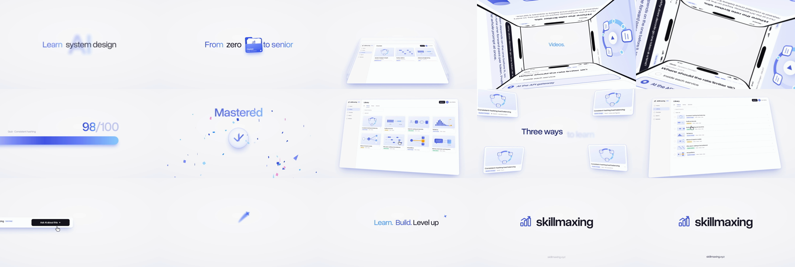

# ad-video-remake

A Claude Code skill for remaking a reference ad or launch video for another brand: same timeline, same motion,
same sound structure, the brand's own name and content. Every shot is drawn in one HTML file, filmed frame by
frame in headless Chromium, and scored with ElevenLabs music and sound effects (or synthesised stand-ins).



## Install

Copy the skill into your skills folder, for yourself or for one project:

```
cp -r skills/ad-video-remake ~/.claude/skills/                # every project
cp -r skills/ad-video-remake <project>/.claude/skills/        # one project
```

Then give Claude Code a reference and a brand: *"here's the video: <url>. I want the same animation and sound for
<brand>, with our content."*

Requirements, once:

```
pip install playwright numpy pillow imageio-ffmpeg yt-dlp      # faster-whisper optional, for transcripts
python -m playwright install chromium
```

For the music and effects, set `ELEVENLABS_API_KEY` in the environment or in a `.env` / `.env.local`. Without it
the build still finishes, with a synthesised bed and effects.

## What's inside

| path | what it is |
| --- | --- |
| `skills/ad-video-remake/SKILL.md` | the workflow Claude follows: analyse, map beats, build the stage, score, render |
| `skills/ad-video-remake/scripts/analyze_reference.py` | download a reference; contact sheets, tempo, onsets, loudness, transcript |
| `skills/ad-video-remake/scripts/build.py` | film a stage, add effects and music, mux; `--at` contact sheets; `--audio-from` |
| `skills/ad-video-remake/templates/stage.html` | worked example: the 33 s Skillmaxing launch ad, nine scenes |
| `skills/ad-video-remake/templates/config.json` | its sound cues, effect prompts, music sections and lyrics |
| `skills/ad-video-remake/reference/techniques.md` | what took iteration: 3D phone ring, handovers, trails, colour range, sound |
| `examples/skillmaxing-launch/` | the beat map from the reference to the Skillmaxing cut |

## Run the example by hand

```
cd skills/ad-video-remake
python scripts/build.py --stage templates/stage.html --config templates/config.json --out out --at 1.5,7.3,13.5,28.9
python scripts/build.py --stage templates/stage.html --config templates/config.json --out out
```

The first command writes `out/work/at.png`, a sheet of those four moments. The second writes
`out/skillmaxing-launch-16x9.mp4`, in about 30 seconds.

Fonts: Overused Grotesk, SIL Open Font License 1.1 (`templates/fonts/LICENSE.txt`).
