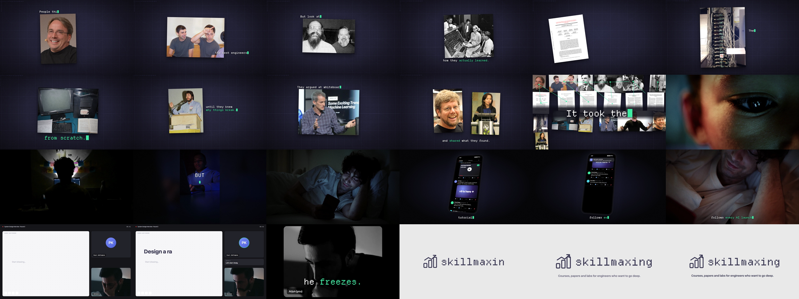

# Skillmaxing story film: storyboard

The narrated opening of the Skillmaxing brand film, built from `skills/story-film/templates/story.json`.
1920 x 1080, 60 fps, 44.4 s. The narrator is ElevenLabs "Eric"; the times below are from that render and move with
the narration if it is regenerated.

| seconds | narration | picture |
| --- | --- | --- |
| 0.5 – 3.5 | People think the best engineers were just born smarter. | Torvalds, Page and Brin, Turing (b/w) pinned to the dark mat; "People think", "the best engineers", "were just *born smarter.*" |
| 4.0 – 6.3 | But look at how they actually learned. | Thompson and Ritchie, Hopper at the UNIVAC; "how they *actually learned.*" |
| 6.8 – 9.5 | They went deep. They read the papers everyone else skipped. | Hamilton beside her stack of code ("They went *deep.*"), then six first pages fan up: Attention, MapReduce, Shannon, Bitcoin, Raft, Dynamo |
| 10.0 – 14.4 | They rebuilt systems from scratch, until they knew why things break. | Google's first server rack, the first web server, Wozniak |
| 14.9 – 18.4 | They argued at whiteboards, and shared what they found. | Jeff Dean, Karpathy, then Guido van Rossum and Fei-Fei Li side by side |
| 18.9 – 21 | It took them years. | every picture at once, pulled back, joined by drawn mint lines; "It took them *years.*" |
| 21.5 – 22.6 | Meet Arjun. | eye close-up, "meet *Arjun*" |
| 23.1 – 26.3 | He's a good engineer. But he wants to be a great one. | silhouette at a desk of monitors; portrait clip in blue light: "BUT he wants to be a *great* one." |
| 26.8 – 33.6 | He saves every roadmap. Watches tutorials at two x. Follows every AI launch. | in bed with the phone; the phone itself: a roadmap thread bookmarked, a "System design in 10 min" video at 2x, a launch toast; his face in its light |
| 34.1 – 38.1 | But when the interviewer says: design a rate limiter... he freezes. | a video call: the question types onto the whiteboard; on "freezes" his camera holds, the frame drains and tears, the music stops dead |
| 39.0 – 44.4 | Skillmaxing changes that. | the mark draws itself on grey, a riser, an impact and a sting; "Courses, papers and labs for engineers who want to go deep." |

Sound: a composed documentary underscore (piano, pad, ticking pulse, building) cut at the freeze with a tape stop;
typewriter ticks on the captions, a photo slap on each cut, paper for the fan, phone buzz and scroll, heartbeats
under the question, then riser, impact and sting on the logo.

Credits for the photos are in `CREDITS.md`. The social posts' names and handles and the interviewer are invented
for the film.
